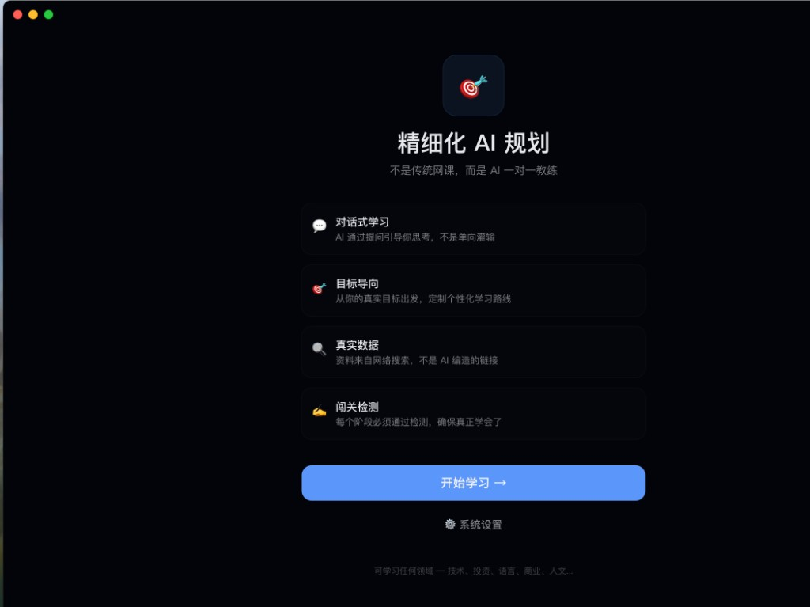
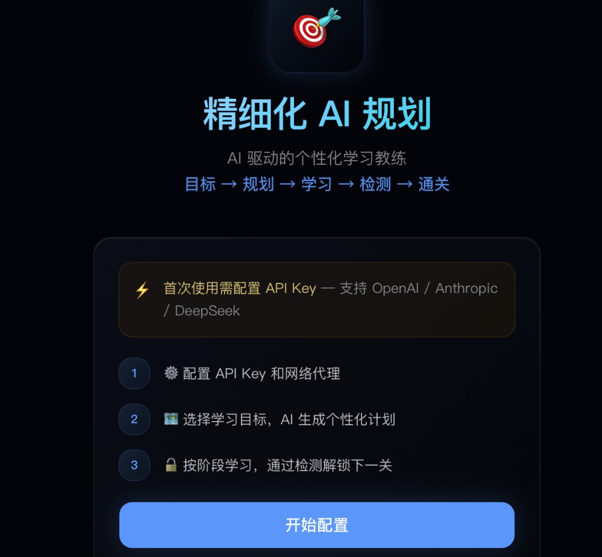
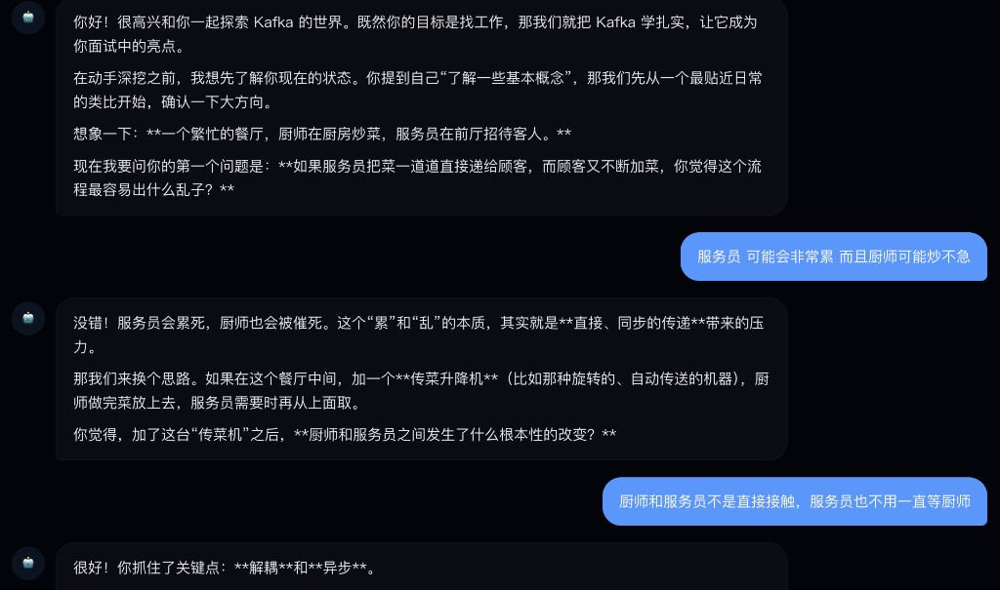
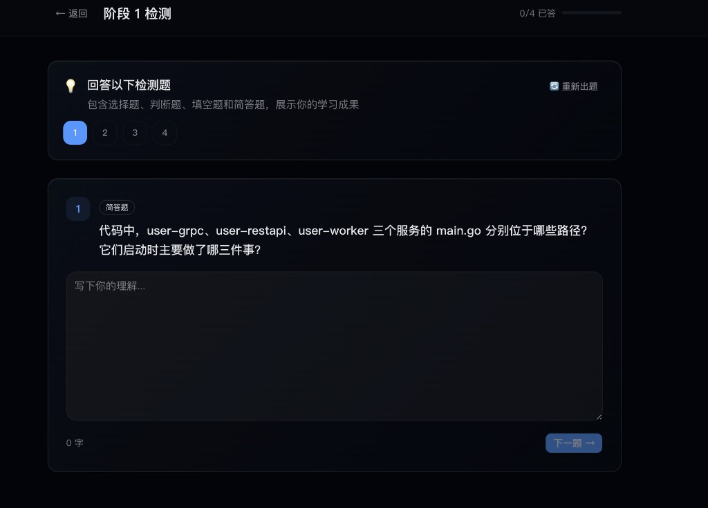
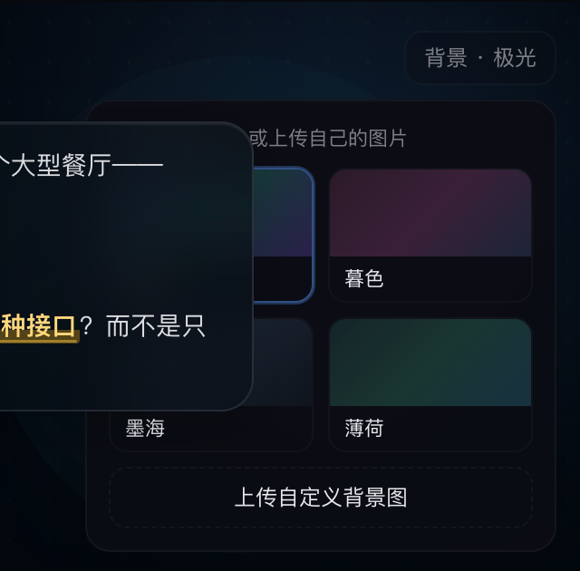
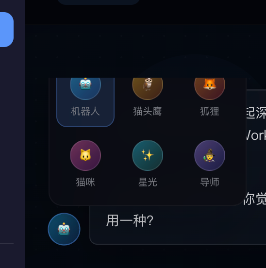

# AI 精细化学习规划

基于 Next.js + Electron 的本地 AI 学习教练。支持按目标 / 书籍 / 代码仓库生成阶段计划，用苏格拉底式对话教学，并通过检测、复习、知识图谱与模拟面试形成闭环。数据保存在本地 SQLite，不依赖外部数据库。

## 界面预览

| 首页 | 首次配置 |
|:---:|:---:|
|  |  |

| AI 教学对话 | 阶段检测 |
|:---:|:---:|
|  |  |

| 教学背景主题 | 导师头像 |
|:---:|:---:|
|  |  |

## 功能概览

### 建计划
- **三种来源**：学习目标 / 上传书籍 / 导入本地代码仓库
- **学习者画像**：可选学习模式与职级身份
  - 学习模式：业务 / 技术 / 业务×技术
  - 职级：初级 / 高级 / 资深（可选）
  - 熟悉度：完全不了解 / 知道一些 / 有一定研究
- **代码计划策略**：业务×技术 + 高级/有基础时，优先从**接口 / 路由 / Handler**切入，而不是从 `main` 语法热身开始

### 阶段学习
- **大纲确认门禁**：进入阶段先看可编辑大纲（目标、场景、精读文件、调用链、排除项），确认后才开始 AI 教学
- **AI 对话教学**：证据 / 推断 / 未知协议；代码计划会真实读取仓库文件
- **学习模式切换**：学习页可随时在业务 / 技术 / 业务×技术间切换
- **重新开聊**：按当前画像清空并重启本阶段教学对话
- **细粒度进度**：目标、场景、精读文件、架构理解、检测等进度项
- **业务场景练习**：讨论结束后可生成带源码引用的结论
- **服务架构视图**：代码计划可查看基于仓库文件的服务级架构（已验证 / 推断）
- **阶段检测**：通过后解锁下一阶段；也可跳过检测

### 面试
- **计划级 / 阶段级模拟面试**：友善 / 标准 / 压力三种风格
- **回答倒计时**：可选开启，默认 120 秒；以服务器收到回答时间为准
- **跨计划融合面试**：可选择 2–5 个计划合练（例如 Kafka + Redis）

### 其他
- 资料推荐、实战项目、知识图谱、间隔复习、学习洞察、导出
- 教学界面：头像、背景主题、重点词高亮

## 技术栈

| 层级 | 技术 |
|------|------|
| 前端 | Next.js 16 + React 19 + TypeScript + Tailwind CSS 4 |
| UI | shadcn/ui + Recharts + React Flow |
| AI | Vercel AI SDK（OpenAI / Anthropic / DeepSeek / Kimi） |
| 数据 | SQLite（better-sqlite3，本地） |
| 桌面 | Electron 43 + electron-builder |

## 环境要求

- **Node.js** >= 18（推荐 20+）
- **pnpm**（推荐）或 npm
- C/C++ 编译工具链（`better-sqlite3` 需要）
  - macOS: `xcode-select --install`
  - Windows: Visual Studio Build Tools
  - Linux: `sudo apt install build-essential python3`

## 本地安装与运行

### 1. 克隆

```bash
git clone git@github.com:QIYUEKURONG/ai-learning-planner.git
cd ai-learning-planner
```

### 2. 安装依赖

```bash
pnpm install
# 或
npm install
```

### 3. 启动

**Web**（http://localhost:3000）：

```bash
pnpm dev
```

**Electron 桌面**（端口 3456）：

```bash
pnpm electron:dev
```

### 4. 配置 AI

启动后进入设置页配置：

| 配置项 | 说明 |
|--------|------|
| LLM 提供商 | `openai` / `anthropic` / `deepseek` / `kimi` |
| API Key | 对应提供商密钥 |
| Base URL | 自定义 API 地址（可选） |
| 模型 | 模型名称（可选） |
| Tavily API Key | 增强资源搜索（可选） |
| 重点词下划线高亮 | 教学对话强调效果（默认开启） |

## 构建桌面应用

打包并安装到 `/Applications`：

```bash
pnpm electron:desktop
```

产物：

- `dist/mac-arm64/精细化AI规划.app`
- `/Applications/精细化AI规划.app`

仅打包到 `dist/`：

```bash
pnpm electron:build
```

Web 生产构建：

```bash
pnpm build
pnpm start
```

## 推荐使用路径（代码仓库学习）

1. 新建计划 → 选择本地代码路径
2. 选择 **业务×技术**，职级选 **高级**（或按真实水平选择）
3. 确认计划后进入阶段 → 先调整/确认大纲
4. 开始 AI 教学：优先做接口与业务链路分析
5. 需要换切入方式时，可切换学习模式或点「重新开聊」
6. 查看「服务架构」、完成场景练习与阶段检测
7. 需要合练多个技术栈时，使用「跨计划面试」

## 项目结构

```
├── src/
│   ├── app/                      # 页面 + API
│   │   ├── interview/multi/      # 跨计划面试
│   │   ├── plan/[id]/            # 计划主界面 / 架构 / 面试
│   │   └── api/                  # outline / progress / scenarios / architecture / interview
│   ├── components/
│   │   ├── stage-outline-gate.tsx
│   │   ├── stage-progress-panel.tsx
│   │   ├── stage-scenarios-panel.tsx
│   │   ├── learning-mode-switcher.tsx
│   │   ├── interview-countdown.tsx
│   │   └── teach-chat.tsx
│   ├── db/                       # schema + queries（含 schema v3）
│   └── lib/
│       ├── prompt-composer.ts    # 教学模式 / 职级 / 证据协议
│       ├── source-selector.ts    # 确定性源码选择
│       ├── outline-*.ts          # 大纲生成与校验
│       ├── architecture-scanner.ts
│       └── interview-*.ts
├── electron/main.js
├── docs/screenshots/
├── data/                         # 开发期 SQLite
└── scripts/                      # standalone 准备 / 安装到 Applications
```

## 数据存储

- **开发模式**: `./data/learning-planner.db`
- **Electron 打包后（macOS）**: `~/Library/Application Support/ai-learning-planner/data/`
- 全部本地存储，无需外部数据库

## 说明

- 旧计划在迁移后可继续使用；新解锁阶段会要求确认大纲
- 「业务×技术 + 高级」的接口优先策略主要影响**新生成的代码计划**与**重新开聊后的教学对话**
- 面试倒计时为练习节奏工具，不保证防作弊；以服务器收到回答的时间为准
